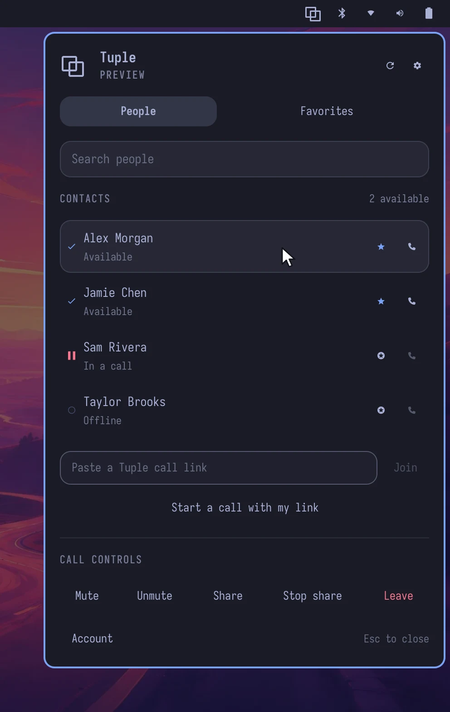
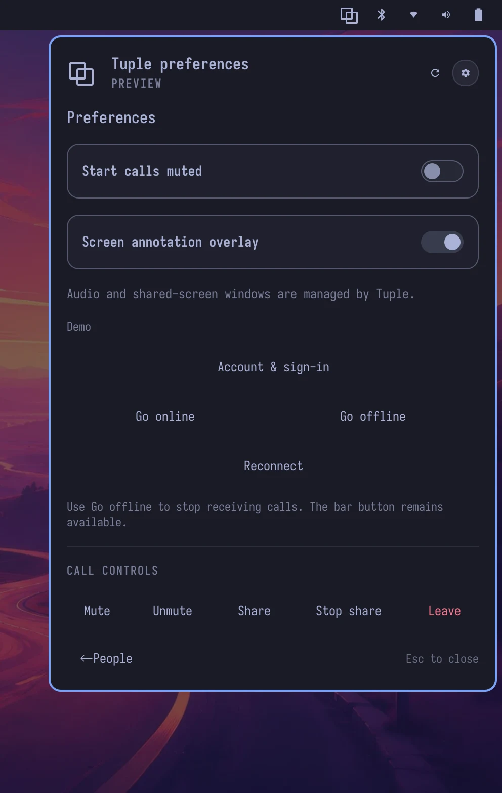

# Otuple

An Omarchy bar widget for the Tuple Linux CLI. Its bar button opens a panel with searchable contacts, presence, favorites, call links, microphone and screen-sharing controls, preferences, and sign-in.



## Requirements

- Omarchy, with its Quickshell shell and plugin support.
- The Tuple Linux CLI: the official ARM64 or x86_64 `tuple` executable on `PATH`, from the [Tuple Linux installer](https://tuple.app/linux/). Otuple never downloads or upgrades Tuple.
- Python 3.

## Install

```sh
omarchy plugin add https://github.com/kierangraham/otuple --enable
```

This clones the repository into `~/.config/omarchy/plugins/kierangraham.otuple` and adds the button to the right bar section. To place it just before the tray:

```sh
omarchy plugin enable kierangraham.otuple --section right --before omarchy.tray
```

Optionally, add an `otuple` command and desktop launcher under `~/.local` from a checkout of this repository:

```sh
make install-launcher
```

Update with `omarchy plugin update kierangraham.otuple`. Remove with `omarchy plugin remove kierangraham.otuple`, and `make uninstall-launcher` if you installed the launcher.

## Usage

Click the bar button to toggle the panel. Escape or clicking outside closes it. Ctrl+F focuses search, Ctrl+R refreshes, Ctrl+, opens preferences, and Enter in search calls the first available matching contact. With the launcher installed, `otuple` opens the panel and `otuple --background` leaves it closed.



One shared backend serves every monitor. Contacts and preferences refresh every ten seconds. Favorites and actions run the CLI asynchronously and show errors in the panel. "Go offline" stops Tuple and pauses polling; "Go online" resumes it. The button stays visible when offline. Incoming-call prompts and shared-screen windows stay with Tuple. The panel uses Omarchy's own components, so theme changes apply with the rest of the shell.

## Demo mode

`otuple --demo` shows sample contacts and never runs Tuple. Running `otuple` again switches back to live contacts.

## Tuple CLI support

On 5 October 2026, Tuple's official latest ARM64 release endpoint returned `v2026_09_16.1` (SHA-256 `75d405d416be504b24c66e0f2b801d4511408ca3254a26f9e984874717085008`). That release uses `ls`, `call USER_ID`, `favorite`, `new`, `join`, `mute`, `unmute`, `share`, `unshare`, `end`, `on`, and `off`. It does not expose JSON output or live call state. Otuple parses its contact listing and uses explicit Mute/Unmute and Share/Stop share buttons; it does not claim a call or microphone state it cannot read.

The current [Tuple CLI reference](https://docs.tuple.app/cli/commands), labelled macOS, documents `--format json`, `contacts list`, `state`, and `call start`. Otuple includes an adapter for that interface, selected only if the installed binary's help supports it. Mocked tests cover the adapter, but it has not been verified with a Linux release providing that interface.

Set `OTUPLE_CLI` in the Omarchy shell's environment to use a different `tuple` binary.

The Python backend (`backend.py`) sends JSON Lines to the plugin service over standard output. Commands arrive on standard input and run as argument arrays without a shell. Authorization codes are passed only to `tuple auth` and never stored by Otuple. Tuple owns account credentials and settings.

## Development

```sh
make check
```

This runs the backend tests, shell syntax validation, QML lint, `omarchy plugin validate`, and desktop-entry validation. QML lint checks Omarchy's dynamic font, spacing, and color members against the installed shell source, because their declared `QtObject` type hides those members from the static linter. Tests do not place calls or change account preferences.

## Licence

MIT. See [LICENSE](LICENSE).

---

[kierangraham.com](https://kierangraham.com)
